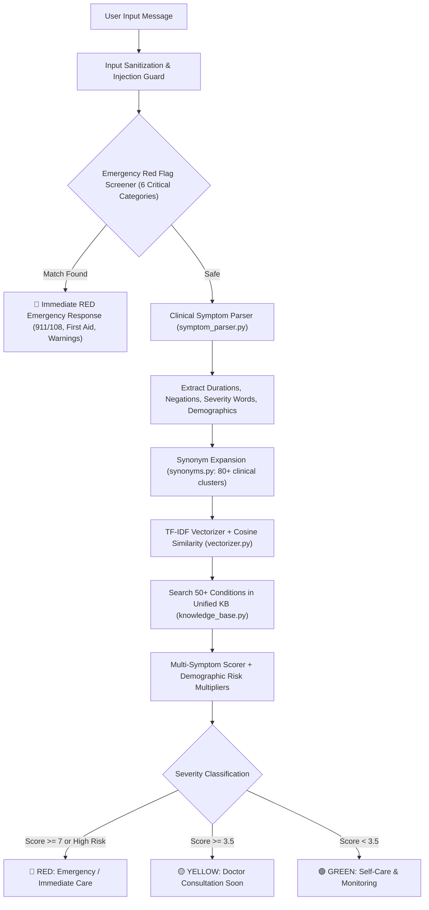

# 🏥 CareNexus — Comprehensive LLM Handoff & Architecture Blueprint

> **Notice for Any Incoming AI Assistant / Engineer:**  
> This single document contains the complete context, design philosophy, file-by-file directory map, test suites, recent iterations, and pending backlog for **CareNexus**. You do **not** need to scan every file in the repository — everything you need to know to immediately be productive is detailed here.

---

## 📌 1. Project Overview & Context

- **Project Name:** CareNexus ("Your First Point of Care")
- **Student Developer:** Sarthak Saxena (4th-year B.Tech Student)
- **Nature of Project:** Final Year Capstone Project (AI-Powered Medical Chatbot & Clinical Triage System)
- **Time Remaining to Final Submission:** **~3 Days**
- **Public GitHub Repo:** `https://github.com/sarthaksaxenaa/CareNexus`
- **Current Branch:** `main` (directly pushed with granular Conventional Commits)
- **Quality Standard:** Enterprise SDE-3 grade architecture, 100% passing automated tests, zero console errors, clean type safety, and maximum GitHub contribution graph fidelity ("green squares" via atomic, meaningful commits).

---

## ⚙️ 2. Execution Environment & Hard System Constraints

| Component | Constraint / Rule | Details / Rationale |
|---|---|---|
| **Operating System** | **Windows 11** | Use PowerShell-compatible syntax. Use `;` instead of `&&` for command chaining. |
| **Python Version** | **Python 3.13.3** | Dedicated virtual environment at: `backend\venv\Scripts\python.exe`. Always run backend commands through this venv. |
| **Node.js Version** | **Node.js 22.16.0** | Frontend at `frontend/`. Uses Next.js 16 (Turbopack) with React 19. |
| **Database** | **SQLite Only (`backend/carenexus_dev.db`)** | **Strict constraint:** No Docker daemon, no PostgreSQL server, no Redis instance is installed locally. Uses `sqlite+aiosqlite:///./carenexus_dev.db`. |
| **AI / LLM Mode** | **Offline TF-IDF + Synonym RAG Fallback** | No paid Gemini/OpenAI API keys are configured on local dev. The system operates autonomously via deterministic TF-IDF cosine similarity, emergency red-flag triggers, and rule-based medical triage. (LLM service integration is fully coded and activates if `GEMINI_API_KEY` or `OPENAI_API_KEY` is present in `.env`). |
| **One-Click Launcher** | **`python run.py`** | Starts FastAPI on `http://127.0.0.1:8000` and Next.js on `http://localhost:3000` concurrently. |
| **Git Commit Protocol** | **Atomic Conventional Commits** | Format: `feat(...)`, `fix(...)`, `refactor(...)`, `test(...)`, `chore(...)`. User requests small, granular pushes directly to `main`. |
| **Line Endings** | **CRLF / LF Handling** | On Windows, text tools can encounter CRLF mismatches. If `edit_file` encounters whitespace issues, execute Python scripts or use `write_file` directly. |
| **Console Encoding** | **Windows Console Unicode** | Windows PowerShell stdout charmap can fail on emoji / non-ASCII characters without `encoding="utf-8", errors="replace"`. |

---

## 🏛️ 3. Core Architecture & Design Decisions

### 3.1 Backend Architecture (`FastAPI` + `SQLAlchemy 2.0 Async` + `Pydantic v2`)
- **Non-blocking Async Database I/O:**  
  Engine initialized via `create_async_engine("sqlite+aiosqlite:///./carenexus_dev.db")`. `get_db` dependency yields an `AsyncSession` per request with automatic transaction rollback on failure.
- **Stateless JWT Authentication:**  
  Passwords hashed via `bcrypt` (through `passlib`). Dual-token strategy: short-lived `access_token` (HS256) and long-lived `refresh_token`. Protected routes use `get_current_user` FastAPI dependency.
- **Security & Defense in Depth:**
  - `rate_limiter.py`: In-memory sliding-window IP rate limiting (10 req/min on chat, 5 req/min on auth).
  - `sanitizer.py`: Strips dangerous HTML tags (`<script>`, `<iframe>`, `javascript:`) and guards against prompt injections using 12 regex attack signatures.
  - `middleware.py`: Injects `X-Content-Type-Options: nosniff`, `X-Frame-Options: DENY`, `Referrer-Policy: strict-origin-when-cross-origin`, plus request latency logging.
  - `exceptions.py`: Typed exception hierarchy (`CareNexusException`, `DatabaseException`, `AuthenticationError`, `RAGException`, `LLMServiceException`) with centralized exception handlers in `main.py`.

### 3.2 Clinical Triage & RAG Intelligence Engine
The clinical decision engine processes user queries in a strict 4-stage pipeline:


1. **Stage 1 — Emergency Red Flag Screener (`red_flags.py`):**  
   Evaluates 6 life-threatening categories (cardiac chest pain/radiation, anaphylaxis, acute respiratory failure, stroke/neurological deficits, acute surgical abdomen, sepsis/shock). If triggered, bypasses further processing and returns an instant 🔴 RED response with emergency call instructions and immediate first aid.
2. **Stage 2 — Clinical Symptom Parser (`symptom_parser.py`):**  
   Regex-driven clinical NLP engine:
   - Detects negations (e.g., `"no fever"`, `"denies chest pain"`) so negated symptoms are excluded from scoring.
   - Extracts duration (`"for 3 days"`, `"past 2 weeks"`).
   - Extracts severity modifiers (`"mild"`, `"moderate"`, `"severe"`, `"unbearable"`, `"excruciating"`).
   - Identifies body parts and demographic factors (infants, elderly, pregnancy).
3. **Stage 3 — Synonym Expansion (`synonyms.py`) & Vector Search (`vectorizer.py`):**  
   Expands vernacular lay terms to clinical terms (e.g. `"tummy upset"` -> `"nausea"`, `"vomiting"`, `"gastroenteritis"`, `"dyspepsia"`). Uses a lightweight, high-speed TF-IDF matrix over 50+ curated medical conditions across 10 categories (`knowledge_base.py` + `knowledge_base_extended.py`) containing ICD-11 codes, first aid steps, and red flags.
4. **Stage 4 — Demographic Risk Adjustment & Multi-Symptom Scoring (`engine.py`):**  
   Calculates weighted severity scores based on matched symptoms, patient age, gender, and pre-existing medical conditions. Generates structured triage guidance (Level: Green/Yellow/Red, Sources, Recommendations, Precautions).

### 3.3 Frontend Architecture (`Next.js 16` + `Tailwind CSS v4` + `React 19`)
- **Next.js App Router Structure:**  
  - Static Pre-rendered Pages: Landing page (`/`), About (`/about`).
  - Interactive Client Pages (`use client`): Chat (`/chat`), Analytics Dashboard (`/dashboard`), Health Profile (`/profile`), Auth (`/login`, `/register`).
- **Unified API Client (`src/lib/api.ts`):**  
  Class-based singleton managing JWT authentication headers, local storage persistence, and response envelope unwrapping.
  - *Critical fix applied:* Endpoints `/chat/sessions` and `/chat/sessions/{id}/messages` return wrapped dictionaries `{"sessions": [...]}` and `{"session_id": "...", "messages": [...]}`. `api.ts` extracts the array directly so consumer components never fail on `.map()`.
- **Reusable Component System:**
  - `Navbar.tsx`: Responsive navigation header with active-link indicators and auth-aware login/logout toggles.
  - `ChatSidebar.tsx`: Collapsible conversation history drawer with session timestamps, message counters, and new chat launcher.
  - `MessageBubble.tsx`: Formatted chat messages with triage badges (🟢 Green / 🟡 Yellow / 🔴 Red), sources citations, and copy functionality.
  - `QuickActions.tsx`: One-click clinical triage chips for rapid symptom entry.
  - `ErrorBoundary.tsx`: React error boundary catching client-side exceptions gracefully.
  - `AuthLayout.tsx`: Shared split-screen layout for registration and authentication.

---

## 📂 4. Complete File Structure & Directory Map

```
CareNexus/
├── run.py                          # One-click launcher: starts FastAPI (8000) & Next.js (3000)
├── README.md                       # Main GitHub project presentation & checkpoint documentation
├── CHANGELOG.md                    # Detailed version release notes (v0.0.1 to v0.5.1+)
├── CONTRIBUTING.md                 # Guidelines for code style, branch structure & conventional commits
├── LICENSE                         # MIT License
├── docker-compose.yml              # Multi-container orchestration config (PostgreSQL + API + Web)
├── nexus.docx                      # Full capstone project documentation report generated for college
│
├── backend/                        # FastAPI Application Root
│   ├── carenexus_dev.db            # Local SQLite database file (auto-generated, gitignored)
│   ├── pytest.ini                  # Pytest configuration (asyncio mode, testpaths, warnings filter)
│   ├── requirements.txt            # Production dependencies (fastapi, uvicorn, sqlalchemy, pydantic, pyjwt, etc.)
│   ├── requirements-dev.txt        # Dev/test dependencies (pytest, pytest-asyncio, httpx, ruff)
│   ├── ruff.toml                   # Ruff linter and formatter configuration
│   │
│   ├── app/
│   │   ├── __init__.py             # Package marker
│   │   ├── main.py                 # FastAPI application factory, CORS, exception handlers, router mounts
│   │   │
│   │   ├── api/
│   │   │   ├── dependencies.py     # Reusable dependencies (get_db, get_current_user)
│   │   │   └── routes/
│   │   │       ├── auth.py         # POST /register, POST /login, GET /me
│   │   │       ├── chat.py         # POST /message, GET /sessions, GET /sessions/{id}/messages
│   │   │       ├── health_profile.py # GET/POST/PUT/DELETE /health-profile/ (Patient medical data)
│   │   │       └── analytics.py    # GET /analytics/overview, GET /analytics/triage-distribution
│   │   │
│   │   ├── core/
│   │   │   ├── config.py           # Pydantic Settings (ENV variables, JWT secret, CORS origins, DB URI)
│   │   │   ├── database.py         # Async engine, sessionmaker, declarative Base
│   │   │   ├── exceptions.py       # Custom exception hierarchy & standard HTTP error bridges
│   │   │   ├── logging_config.py   # Colored, structured console and file logging
│   │   │   ├── middleware.py       # Security headers middleware, latency monitoring
│   │   │   ├── rate_limiter.py     # In-memory sliding-window IP rate limiter
│   │   │   ├── sanitizer.py        # Input sanitization, HTML tag stripper, prompt injection guard
│   │   │   │
│   │   │   └── triage/             # Clinical Triage Engine Core
│   │   │       ├── engine.py       # Multi-symptom triage analyzer with demographic risk weighting
│   │   │       ├── prompts.py      # Structured system prompts and clinical response templates
│   │   │       ├── red_flags.py    # Critical emergency condition patterns (6 life-threatening categories)
│   │   │       └── symptom_parser.py # Regex clinical NLP: negations, durations, severity & body parts
│   │   │
│   │   ├── models/                 # SQLAlchemy 2.0 ORM Models
│   │   │   ├── user.py             # User model (id, email, hashed_password, full_name, is_active)
│   │   │   ├── chat.py             # ChatSession & ChatMessage models (session_id, role, content, triage_level)
│   │   │   └── health_profile.py   # HealthProfile model (age, gender, blood_group, allergies, chronic_conditions)
│   │   │
│   │   ├── rag/                    # Medical Knowledge Base & Information Retrieval
│   │   │   ├── knowledge_base.py   # Master condition catalog (merges core + extended KB into single index)
│   │   │   ├── knowledge_base_extended.py # 30+ extended medical conditions (10 clinical categories, ICD-11)
│   │   │   ├── retriever.py        # High-level RAG query retriever and context assembly
│   │   │   ├── synonyms.py         # 80+ clinical synonym mapping clusters for vernacular query expansion
│   │   │   └── vectorizer.py       # TF-IDF matrix computation and cosine similarity search
│   │   │
│   │   ├── schemas/                # Pydantic v2 Request/Response Schemas
│   │   │   ├── auth.py             # UserRegister, UserLogin, TokenResponse, UserResponse
│   │   │   ├── chat.py             # SendMessageRequest, ChatResponse, SessionResponse, SessionListResponse
│   │   │   ├── health_profile.py   # HealthProfileCreate, HealthProfileUpdate, HealthProfileResponse
│   │   │   └── analytics.py        # AnalyticsSummaryResponse, TriageDistributionResponse
│   │   │
│   │   └── services/               # Business Logic Layer
│   │       ├── auth_service.py     # User registration, verification, JWT generation & password hashing
│   │       └── llm_service.py      # LLM provider wrapper (Gemini / OpenAI / Fallback triage router)
│   │
│   └── tests/                      # Automated Test Suite (205 passing tests)
│       ├── conftest.py             # Pytest fixtures (async engine, in-memory SQLite, test client, test users)
│       ├── test_auth_service.py    # Unit tests for authentication logic & token cycles
│       ├── test_e2e.py             # Full end-to-end user workflows (register -> profile -> chat -> triage)
│       ├── test_edge_cases.py      # Empty strings, unicode inputs, massive payloads, malformed tokens
│       ├── test_exceptions.py      # Custom exception formatting and HTTP status mapping
│       ├── test_health.py          # /health healthcheck endpoint verification
│       ├── test_llm_service.py     # Mocked LLM responses, fallback engine triggering, JSON parsing
│       ├── test_middleware.py      # Security headers, latency headers, rate limit tripping
│       ├── test_rag.py             # RAG vectorizer, synonym expansion, TF-IDF cosine matching
│       ├── test_security.py        # Prompt injection detection, XSS stripping, password hashing safety
│       └── test_triage.py          # Triage scoring, red flag overrides, severity level validation
│
└── frontend/                       # Next.js 16 Web Application Root
    ├── package.json                # Next.js 16, React 19, Tailwind CSS v4, Lucide/Heroicons
    ├── tsconfig.json               # TypeScript strict configuration with path aliases (@/* -> src/*)
    ├── next.config.ts              # Next.js build configuration (Turbopack, image domains)
    │
    └── src/
        ├── app/                    # Next.js App Router Pages
        │   ├── layout.tsx          # Root HTML layout with Navbar and dynamic metadata
        │   ├── page.tsx            # Landing page (hero section, feature cards, triage demo CTA)
        │   ├── globals.css         # Tailwind CSS v4 directives & root theme color variables
        │   ├── icon.tsx            # Dynamic CareNexus SVG medical cross favicon generator
        │   ├── about/page.tsx      # Mission, clinical methodology, disclaimer, technology stack
        │   ├── chat/page.tsx       # Real-time medical chat interface, session selection, live bubbles
        │   ├── dashboard/page.tsx  # Analytics dashboard (triage breakdown charts, recent sessions)
        │   ├── profile/page.tsx    # Health profile editor (CRUD for allergies, medications, conditions)
        │   ├── login/page.tsx      # Sign-in screen using AuthLayout
        │   └── register/page.tsx   # Sign-up screen using AuthLayout
        │
        ├── components/             # Reusable UI Components
        │   ├── Navbar.tsx          # Universal navigation bar with active route highlight & auth status
        │   ├── ChatSidebar.tsx     # Session list sidebar with date formatters & new chat trigger
        │   ├── MessageBubble.tsx   # Message rendering with color-coded triage indicators & sources
        │   ├── QuickActions.tsx    # Quick-select chips for common clinical symptom presentations
        │   ├── AuthLayout.tsx      # Split-screen responsive container for authentication forms
        │   └── ErrorBoundary.tsx   # Client-side crash catcher with recovery UI
        │
        └── lib/                    # Shared Frontend Utilities
            ├── api.ts              # Central ApiClient class handling all REST endpoints & token storage
            └── styles.ts           # Shared Tailwind CSS class constants (INPUT_CLASS, BTN_PRIMARY, etc.)
```

---

## 📜 5. Version History & Completed Iterations

```
v0.0.1 -> v0.1.0 -> v0.2.0 -> v0.3.0 -> v0.4.0 -> v0.5.0 -> v0.5.1 -> v0.5.1+ (Current)
```

| Version / Commit | Milestone / Changes Implemented |
|---|---|
| **v0.0.1 — v0.5.0** | Initial scaffolding, FastAPI setup, SQLAlchemy models, JWT auth, chat endpoints, RAG pipeline, frontend pages, and comprehensive test suite creation (205 tests). |
| **v0.5.1** | Codebase cleanup: replaced deprecated `datetime.utcnow()` with `datetime.now(UTC)`, extracted `AuthLayout.tsx` and `styles.ts`, removed unnecessary `'use client'` from static pages, fixed multi-underscore category bugs. |
| **`c980444`** | `feat(rag): add 30+ extended medical conditions across 10 clinical categories` in `knowledge_base_extended.py`. |
| **`60676c4`** | `feat(rag): add medical synonym expansion` with 80+ clinical synonym clusters in `synonyms.py`. |
| **`40eba7e`** | `feat(triage): add clinical symptom parser` with duration, negation, and severity extraction in `symptom_parser.py`. |
| **`0ca87be`** | `feat(rag): merge extended knowledge base into unified condition index` in `knowledge_base.py`. |
| **`395dcc1`** | `feat(rag): integrate synonym expansion into TF-IDF query vectorization` in `vectorizer.py`. |
| **`51392f0`** | `refactor(triage): upgrade engine with multi-symptom scoring and demographic risk factors` in `engine.py`. |
| **`eef2422`** | `fix(test): update triage fallback test for expanded RAG knowledge base` in `test_triage.py`. |
| **`9d8b6c0`** | `feat: add run.py one-click launcher` to boot backend (port 8000) and frontend (port 3000) simultaneously. |
| **`41d8de9`** | `fix(api): unwrap sessions and messages response envelopes` — resolved the `sessions.map is not a function` error in `src/lib/api.ts`. |
| **`ce58d1d`** | `refactor(chat): use shared ChatSessionInfo type in sidebar` in `ChatSidebar.tsx`. |
| **`3ab6c24`** | `fix(chat): remove unsafe cast on session messages response` in `chat/page.tsx`. |

---

## 🎯 6. Active Request & Immediate In-Flight Task

### User Request:
> *"I decided a theme for this CareNexus and that is a contrast of **JET BLACK (`#050505`)** and **Royal Amethyst (`#3B0A6B`)** and do perform changes and after doing so run the project to localhost so that I can see things."*

### UI Design Specifications for the Theme Overhaul:
- **Base Canvas:** Jet Black (`#050505`)
- **Card / Elevated Surface / Sidebar:** `#0D0614` to `#130920` (Midnight Black with Royal Amethyst undertone)
- **Primary Amethyst Accent:** `#3B0A6B` (Base Royal Amethyst)
- **Vibrant Accent / Hover States:** `#6B21A8` / `#7E22CE` / `#9333EA` / `#A855F7`
- **Subtle Glow / Borders:** `border-purple-900/40` or `#2A0845` with subtle amethyst hover glows
- **Text Contrast:** High-contrast crisp white (`#FFFFFF`) for primary headings, soft lavender (`#E9D5FF` / `#C4B5FD`) for secondary copy, muted purple-gray (`#9CA3AF`) for captions.
- **Triage Level Colors (Preserved for clinical safety):**
  - 🟢 Green: Emerald (`#10B981` / `#059669`)
  - 🟡 Yellow: Amber (`#F59E0B` / `#D97706`)
  - 🔴 Red: Crimson (`#EF4444` / `#DC2626`)

### Files to Update for the Theme Overhaul:
1. `frontend/src/app/globals.css`: Update root CSS variables and dark background default to `#050505`.
2. `frontend/src/lib/styles.ts`: Update `INPUT_CLASS`, `LABEL_CLASS`, `BTN_PRIMARY` to use Royal Amethyst palette.
3. `frontend/src/components/Navbar.tsx`: Dark obsidian bar with amethyst branding, subtle border, and vibrant amethyst active links.
4. `frontend/src/components/ChatSidebar.tsx`: Jet black / amethyst surface, sleek scrollbar, purple-highlighted active chat session.
5. `frontend/src/components/MessageBubble.tsx`: Jet Black/Amethyst message bubbles with glowing borders and crisp readability.
6. `frontend/src/components/QuickActions.tsx`: Amethyst pill buttons with hover micro-animations.
7. `frontend/src/components/AuthLayout.tsx`: Amethyst gradient card with deep jet-black backdrop.
8. `frontend/src/app/page.tsx` (Landing Page): Hero with royal amethyst gradient accents, high-contrast CTA buttons, and glowing feature cards.
9. `frontend/src/app/chat/page.tsx`: Chat container styled with Jet Black background and amethyst input bar.
10. `frontend/src/app/dashboard/page.tsx`: Amethyst-themed metric cards and dark chart containers.
11. `frontend/src/app/profile/page.tsx`: Form inputs with amethyst focus rings and obsidian cards.
12. `frontend/src/app/about/page.tsx`: Deep dark about page with amethyst badges.

---

## 📋 7. Prioritized Backlog for Project Completion (Next 3 Days)

```mermaid
gantt
    title CareNexus 3-Day Completion Schedule
    dateFormat  YYYY-MM-DD
    section Visuals & UX
    Jet Black + Royal Amethyst Overhaul    :active, t1, 2026-10-29, 1d
    Verify on Localhost (:3000 & :8000)   :active, t2, 2026-10-29, 1d
    section Clinical Engine
    Wire Health Profile into Triage Route :t3, 2026-10-30, 1d
    Add Tests for New Medical Modules     :t4, 2026-10-30, 1d
    section Polish & Delivery
    Resolve 11 Starlette Warnings         :t5, 2026-10-31, 1d
    Update README.md to v0.6.0            :t6, 2026-10-31, 1d
    College Presentation Smoke Test       :t7, 2026-10-31, 1d
```

### Backlog Detail:
1. **[PRIORITY 1] Theme Overhaul & Localhost Verification**
   - Apply Jet Black (`#050505`) and Royal Amethyst (`#3B0A6B`) across all pages.
   - Run `python run.py` (or test with next build) and verify in browser.
2. **[PRIORITY 2] Wire Health Profile into Chat Triage Route**
   - In `backend/app/api/routes/chat.py`, fetch the user's `HealthProfile` (if it exists).
   - Pass `patient_age`, `patient_gender`, and `known_conditions` into `analyze_symptoms()` in `engine.py`.
3. **[PRIORITY 3] Add Dedicated Test Suites for Extended Medical Engine**
   - Write tests for `symptom_parser.py` (negations, durations, body parts, demographic risks).
   - Write tests for `synonyms.py` (synonym expansion lookup).
   - Write tests for `knowledge_base_extended.py` (condition counts, ICD codes).
4. **[PRIORITY 4] Clean up Starlette Deprecation Warnings**
   - In `backend/app/main.py` and test routes, upgrade `HTTP_422_UNPROCESSABLE_ENTITY` to `HTTP_422_UNPROCESSABLE_CONTENT`.
5. **[PRIORITY 5] Update README & Version Checkpoint to v0.6.0**
   - Add new screenshots / descriptions of the Jet Black + Royal Amethyst theme, updated test counts, and 50+ medical condition knowledge base.

---

## ⚡ 8. Operational Cheatsheet & Exact Commands

### One-Click Project Launch:
```powershell
python run.py
```
*(Starts backend on http://127.0.0.1:8000 and frontend on http://localhost:3000)*

### Run Automated Backend Tests (205 tests):
```powershell
cd "c:\Users\Sarthak Saxena\Documents\PLACEMENT PREP\09 Capstone Project\CareNexus"
backend\venv\Scripts\python.exe -m pytest backend/tests -v
```

### Verify Frontend TypeScript & Production Build:
```powershell
cd "c:\Users\Sarthak Saxena\Documents\PLACEMENT PREP\09 Capstone Project\CareNexus\frontend"
npx next build
```

### Git Commit & Push Template:
```powershell
git add <files>
git commit -m "<type>(<scope>): <short descriptive summary>"
git push origin main
```

---
*Created on: 2026-10-29 for Sarthak Saxena's Final Year B.Tech Capstone Project — CareNexus.*
