<div align="center">


[](https://github.com/sarthaksaxenaa/CareNexus/actions/workflows/ci.yml)
[](https://github.com/sarthaksaxenaa/CareNexus/actions/workflows/readme-assets.yml)


[](LICENSE)

**Describe what you feel. CareNexus tells you how urgently to get care, and what to do in the meantime.**

[Quick start](#quick-start) · [How it decides](#how-a-message-is-assessed) · [Architecture](#architecture) · [Quality](#quality) · [API](#api)

</div>

<br>

<p align="center">
  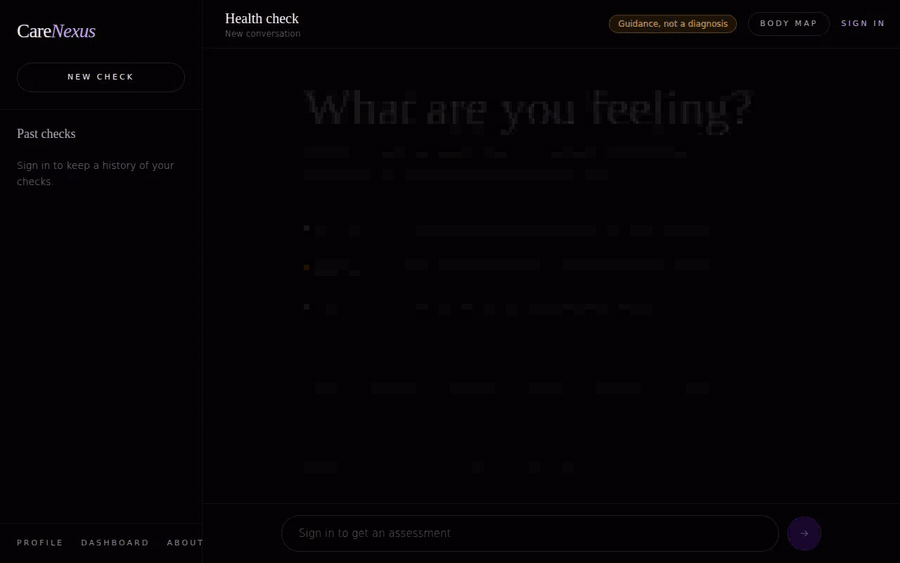
</p>

<p align="center"></p>

## What it does

CareNexus is a **triage** assistant. It does not name your illness; it answers the question that matters first:

| Level | Meaning |
|:--|:--|
| 🟢 **Self-care** | Usually safe to manage at home, with clear signs to watch for |
| 🟠 **See a doctor** | Book an appointment soon; it should be examined in person |
| 🔴 **Emergency** | Get help now: call your local emergency number |

It works **fully offline**. Emergency rules and a search over a curated library of **49 ICD-10-coded conditions** answer every message; a Gemini API key is optional and, when set, writes the reply from the same retrieved knowledge.

<table>
  <tr>
    <td width="50%">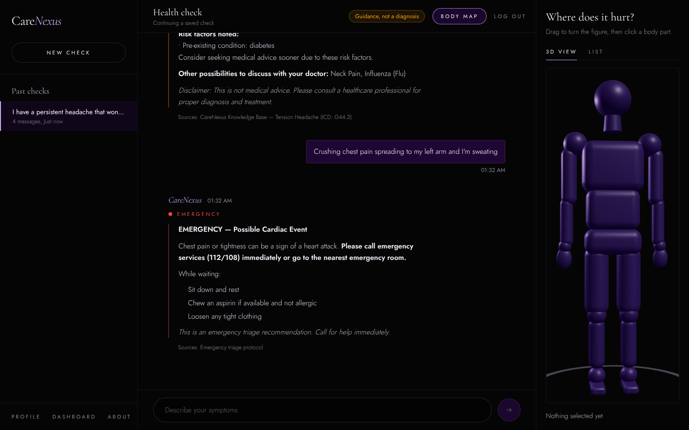<br><sub><b>Chat</b>: graded answers, saved conversations, a 3D body map with a list fallback</sub></td>
    <td width="50%">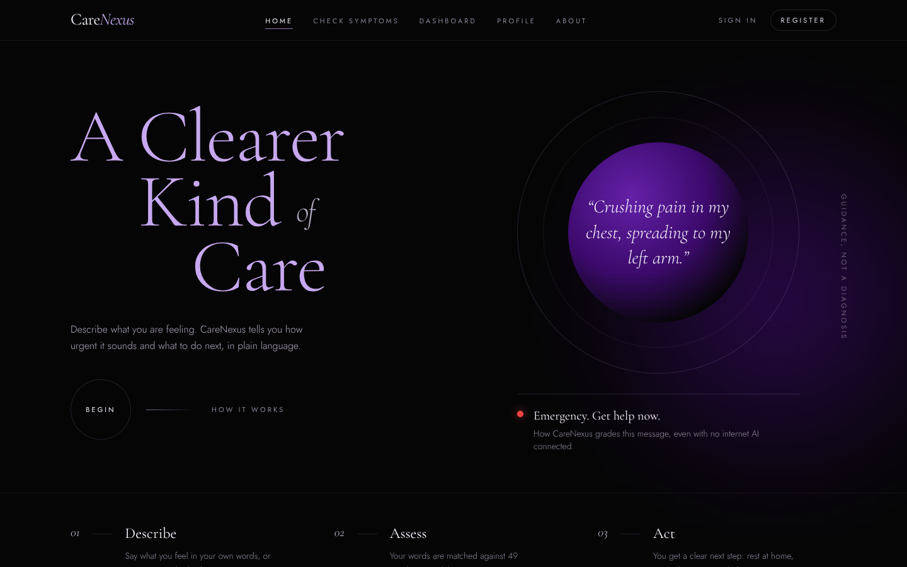<br><sub><b>Home</b>: an editorial interface in jet black and royal amethyst</sub></td>
  </tr>
  <tr>
    <td>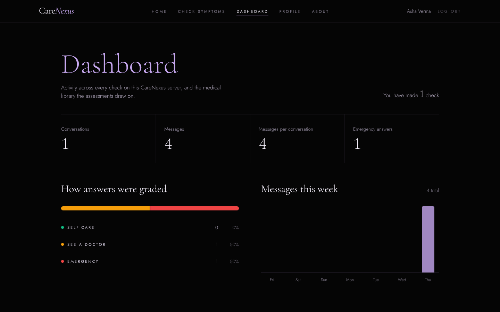<br><sub><b>Dashboard</b>: how answers were graded and weekly activity</sub></td>
    <td>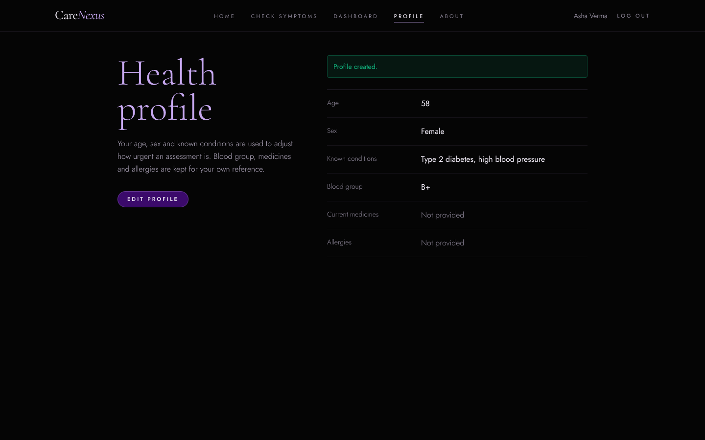<br><sub><b>Health profile</b>: age, sex and conditions adjust the level of concern</sub></td>
  </tr>
</table>

<p align="center">
  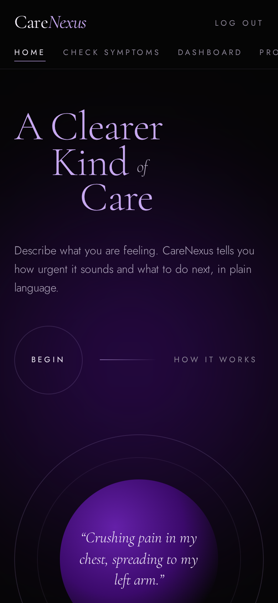
  &nbsp;&nbsp;
  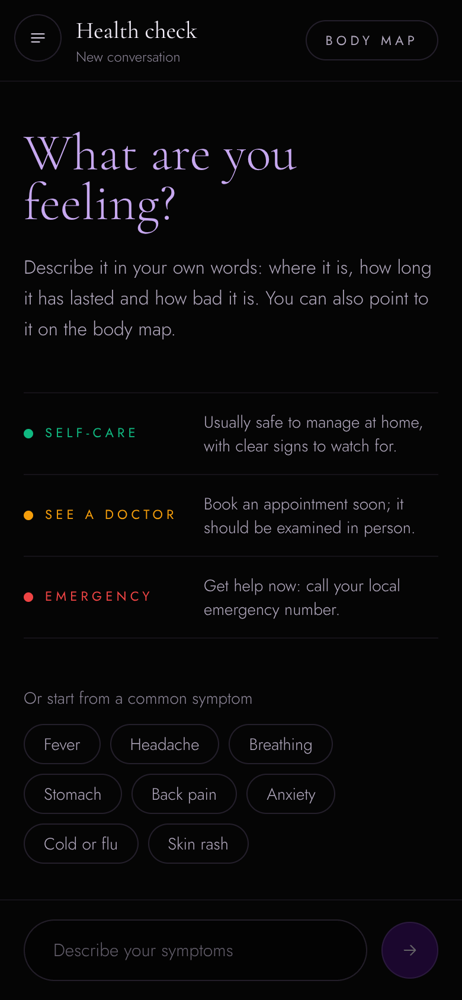
</p>

## Quick start

Requires **Python 3.12+** and **Node.js 20+**.

```bash
git clone https://github.com/sarthaksaxenaa/CareNexus.git
cd CareNexus
python run.py            # Windows: double-click start.ps1
```

`run.py` creates the Python environment, installs dependencies whenever `requirements.txt` or `package-lock.json` changes, starts both servers and opens **http://localhost:3000**. API docs are at **http://localhost:8000/docs**.

No configuration is needed. For Gemini answers, copy `backend/.env.example` to `backend/.env` and set `GEMINI_API_KEY`. With Docker: `docker compose up --build`.

## How a message is assessed

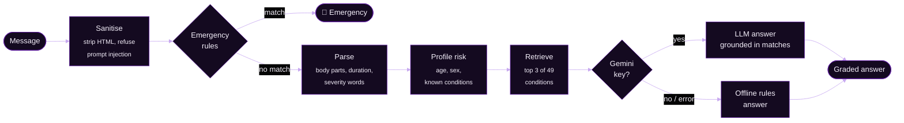

1. **Sanitise.** HTML is stripped; 12 prompt-injection patterns are refused.
2. **Emergency rules first.** Chest pain, stroke signs, breathing difficulty, unconsciousness, severe bleeding and self-harm are answered immediately.
3. **Parse and personalise.** Duration, severity words and the health profile raise the level of concern.
4. **Retrieve.** TF-IDF search with field weighting (a condition's name counts more than its description), light stemming and medical synonyms.
5. **Answer.** Gemini writes the reply from the retrieved conditions, or the offline engine builds it; any LLM failure falls back to offline.

## Architecture

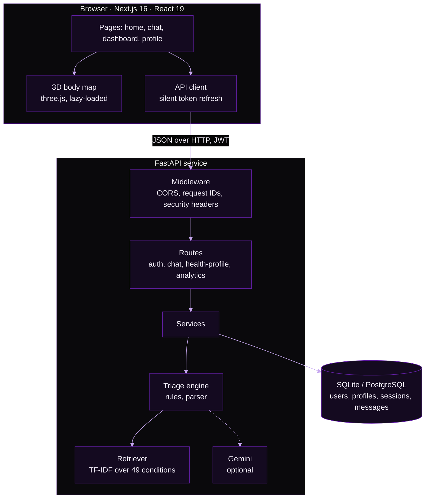

Routes validate and handle HTTP, services hold the logic, models map tables. More in [docs/architecture.md](docs/architecture.md).

## Quality

Every figure on the stats card above is produced by CI from real reports; nothing is typed by hand.

| Suite | Tests | What it covers |
|:--|--:|:--|
| Backend (pytest) | 361 | units, API contracts, security, edge cases, database integrity, retrieval quality |
| Frontend unit (Vitest) | 34 | API client refresh and errors, time parsing, body-map logic |
| End-to-end (Playwright) | 26 | a real browser on the production build, the real API and a database |

**Retrieval accuracy** on everyday-language queries, including every quick-start prompt:

| Query set | Correct first match | Correct in top 3 |
|:--|--:|--:|
| Labelled (43) | 86.0% | 100% |
| Held out, written before tuning (15) | 93.3% | 100% |

Fixing the index (it was matching words in treatment advice rather than symptoms) lifted these from 62.8% and 73.3%. CI fails if they drop.

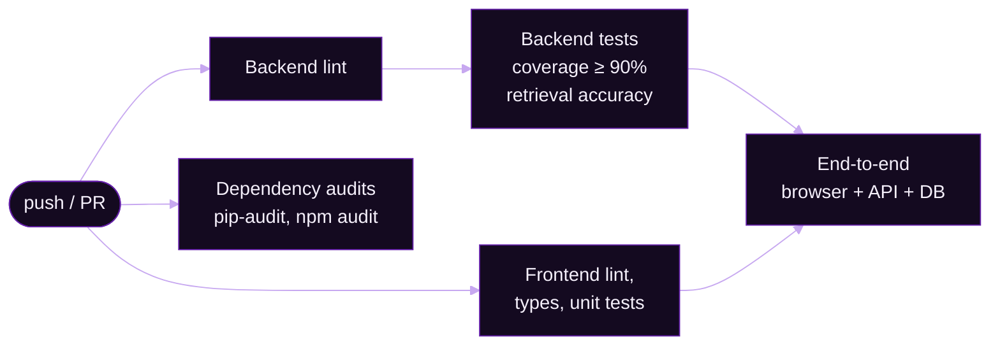

### Security

- Passwords are SHA-256 pre-hashed, then bcrypt (no 72-byte truncation); older hashes upgrade at the next login
- JWT access and refresh tokens with a `type` claim; refresh re-checks that the account is active
- Rate limits: 5/min per IP for sign-in, 10/min **per user** for chat; proxy headers trusted only when configured
- Input sanitising, prompt-injection refusal, and HTML escaped again before rendering
- Foreign keys and cascades enforced by the database, SQLite included
- The API refuses to start in production with the default secret
- Dependabot proposes updates after a 14-day cooldown; CI audits every dependency

**Known limitation:** tokens are kept in `localStorage`, which an XSS flaw could read. A production deployment should move them to `httpOnly` cookies.

## API

Interactive docs: **http://localhost:8000/docs**. All timestamps are UTC with an explicit offset.

<details>
<summary><b>Endpoints</b></summary>

| Method | Endpoint | Description | Auth |
|:--|:--|:--|:--|
| POST | `/api/v1/auth/register` | Create an account | |
| POST | `/api/v1/auth/login` | Sign in, receive tokens | |
| POST | `/api/v1/auth/refresh` | New token pair from `{"refresh_token": ...}` | |
| GET | `/api/v1/auth/me` | Current user | Bearer |
| POST | `/api/v1/chat/message` | Send a message, receive a graded answer | Bearer |
| GET | `/api/v1/chat/sessions` | Conversations, most recent activity first | Bearer |
| GET | `/api/v1/chat/sessions/{id}/messages` | Messages of one conversation | Bearer |
| GET POST PUT DELETE | `/api/v1/health-profile/` | Health profile (PUT: `null` clears a field) | Bearer |
| GET | `/api/v1/analytics/overview` | Totals across the server | Bearer |
| GET | `/api/v1/analytics/my-stats` | The caller's own totals | Bearer |
| GET | `/api/v1/analytics/triage-distribution` | Answers per level | Bearer |
| GET | `/api/v1/analytics/daily-usage?days=1..90` | Messages per day | Bearer |
| GET | `/api/v1/analytics/rag-index` | Library size | Bearer |

</details>

<details>
<summary><b>Project structure</b></summary>

```
CareNexus/
├── backend/
│   ├── app/
│   │   ├── api/routes/        auth, chat, health_profile, analytics
│   │   ├── core/              config, database, middleware, rate limiter, sanitiser
│   │   │   └── triage/        engine, emergency rules, symptom parser, prompts
│   │   ├── rag/               knowledge base (49 conditions), vectoriser, synonyms, retriever
│   │   ├── models/ schemas/   SQLAlchemy models, Pydantic schemas
│   │   └── services/          auth, chat, profile, analytics, LLM
│   ├── scripts/               eval_retrieval.py
│   └── tests/                 pytest suites + labelled retrieval data
├── frontend/
│   ├── src/app/               pages
│   ├── src/components/        navbar, chat sidebar, messages, 3D body map
│   ├── src/lib/               API client, design tokens, triage levels (+ unit tests)
│   ├── e2e/                   Playwright tests
│   └── scripts/readme/        generators for this README's artwork
├── docs/                      architecture.md, generated assets
├── .github/workflows/         ci.yml, readme-assets.yml
└── run.py, start.ps1, docker-compose.yml
```

</details>

<details>
<summary><b>How this README keeps itself current</b></summary>

The banner, stats card, screenshots and demo GIF are generated, not drawn by hand:

| Script | Produces | From |
|:--|:--|:--|
| [`banner.mjs`](frontend/scripts/readme/banner.mjs) | animated SVG header | the app's fonts and colours, embedded |
| [`stats.mjs`](frontend/scripts/readme/stats.mjs) | the stats card | pytest, coverage, Vitest, Playwright, retrieval and audit reports |
| [`capture.mjs`](frontend/scripts/readme/capture.mjs) | screenshots, demo GIF | Playwright driving the running app, ffmpeg |

[`readme-assets.yml`](.github/workflows/readme-assets.yml) runs them weekly and after relevant changes, and commits the results only when something actually changed.

</details>

## Tech stack

| Layer | Technology |
|:--|:--|
| Interface | Next.js 16, React 19, TypeScript, Tailwind CSS 4, three.js with React Three Fiber |
| Service | FastAPI, SQLAlchemy 2 (async), Pydantic 2, PyJWT, bcrypt |
| Data | SQLite (default), PostgreSQL (production) |
| Triage | Rules, TF-IDF retrieval, optional Google Gemini |
| Quality | pytest, Vitest, Playwright, Ruff, ESLint, pip-audit, npm audit |
| Delivery | GitHub Actions, Dependabot, Docker |

## Disclaimer

CareNexus is a final-year capstone project. It gives general health information and is **not** a substitute for professional medical advice, diagnosis or treatment. In an emergency, call your local emergency number.

<div align="center"><sub>MIT licensed · built by <a href="https://github.com/sarthaksaxenaa">Sarthak Saxena</a></sub></div>
