<picture>
  <source media="(prefers-color-scheme: dark)" srcset="docs/assets/banner-dark.svg">
  
</picture>

<div align="center">

[](https://github.com/sarthaksaxenaa/CareNexus/actions/workflows/ci.yml)
[](https://github.com/sarthaksaxenaa/CareNexus/actions/workflows/readme-assets.yml)
[](https://carenexus-health.vercel.app)
[](https://github.com/sarthaksaxenaa/CareNexus/commits/main)
[](LICENSE)

### [Try it live → carenexus-health.vercel.app](https://carenexus-health.vercel.app)

<sub>Create an account in seconds; no AI key needed, the engine runs on its own. The API sleeps when idle, so the very first request can take up to a minute.</sub>

[What it does](#what-it-does) · [See it](#see-it) · [Run it](#run-it) · [Production](#production) · [Quality](#quality) · [How it decides](#how-a-message-is-assessed) · [Architecture](#architecture) · [Engineering](#engineering)

</div>

## What it does

CareNexus is a **triage** assistant. It does not name your illness; it answers the question that matters first: *how urgently should I get care?*

| Level | Meaning |
|:--|:--|
| 🟢 **Self-care** | Usually safe to manage at home, with clear signs to watch for |
| 🟠 **See a doctor** | Book an appointment soon; it should be examined in person |
| 🔴 **Emergency** | Get help now: call your local emergency number |

<picture>
  <source media="(prefers-color-scheme: dark)" srcset="docs/assets/features-dark.svg">
  
</picture>

<picture>
  <source media="(prefers-color-scheme: dark)" srcset="docs/assets/divider-dark.svg">
  
</picture>

## See it

<p align="center">
  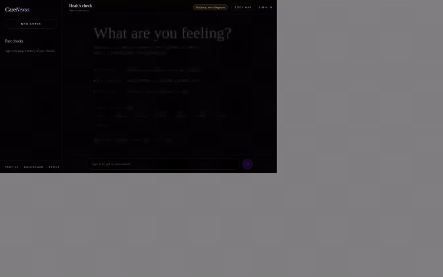
</p>

<table>
  <tr>
    <td width="50%">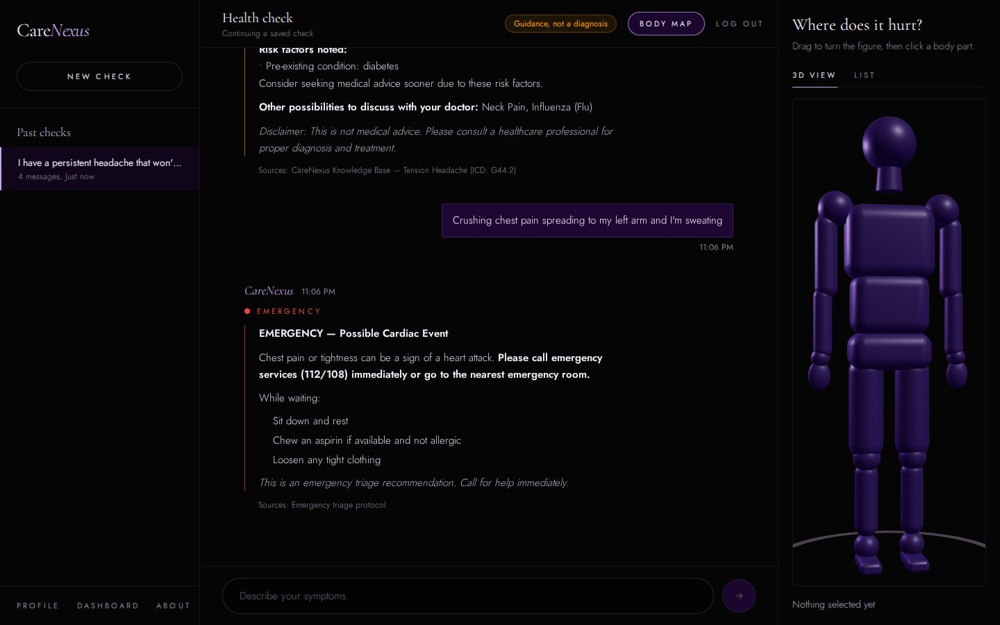<br><sub><b>Chat</b>: graded answers, saved conversations, a 3D body map with a list fallback</sub></td>
    <td width="50%">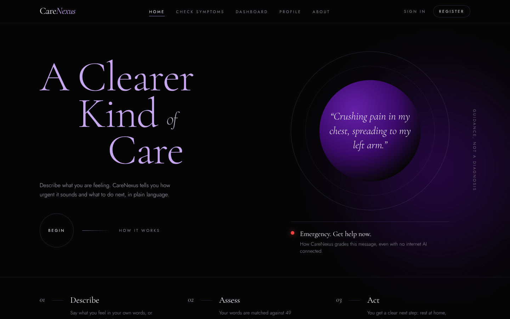<br><sub><b>Home</b>: an editorial interface in jet black and royal amethyst</sub></td>
  </tr>
  <tr>
    <td>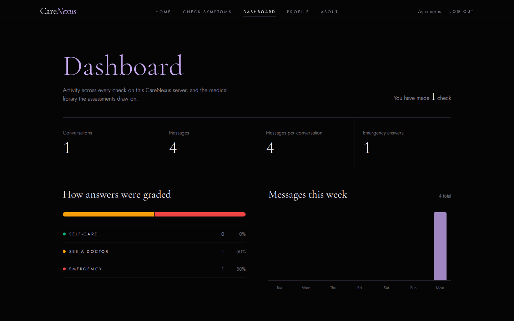<br><sub><b>Dashboard</b>: how answers were graded and weekly activity</sub></td>
    <td>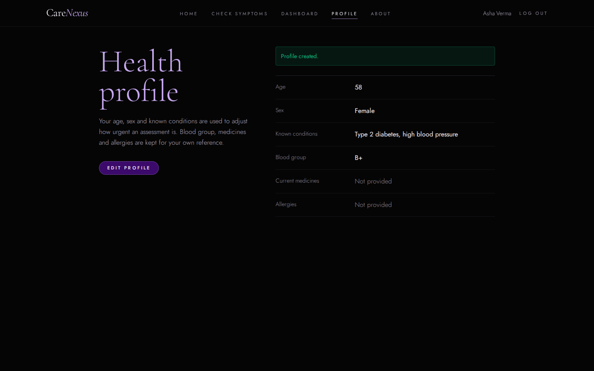<br><sub><b>Health profile</b>: age, sex and conditions adjust the level of concern</sub></td>
  </tr>
</table>

<p align="center">
  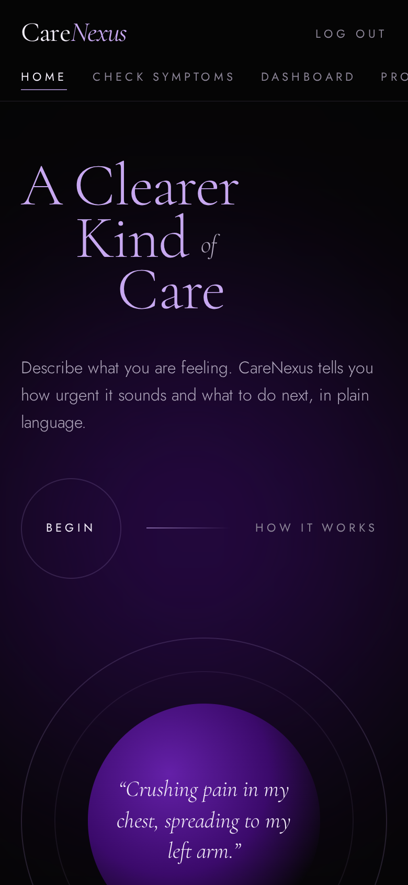
  &nbsp;&nbsp;
  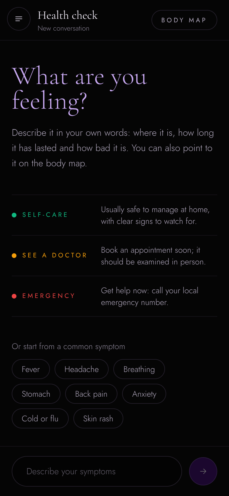
</p>

## Run it

Requires **Python 3.12+** and **Node.js 20+**.

```bash
git clone https://github.com/sarthaksaxenaa/CareNexus.git
cd CareNexus
```

| Platform | Start |
|---|---|
| Windows | double-click **`start.cmd`** |
| macOS / Linux | `./start.sh` |
| Anywhere | `python run.py` &nbsp;·&nbsp; or `docker compose up --build` |

`run.py` creates the Python environment, installs dependencies only when `requirements.txt` or `package-lock.json` changed (it hashes them), starts both servers and opens **http://localhost:3000**. API docs are at **http://localhost:8000/docs**. No configuration needed; for Gemini-written answers, set `GEMINI_API_KEY` in `backend/.env`.

<picture>
  <source media="(prefers-color-scheme: dark)" srcset="docs/assets/divider-dark.svg">
  
</picture>

## Production

<picture>
  <source media="(prefers-color-scheme: dark)" srcset="docs/assets/status-dark.svg">
  
</picture>

<sub>Probed from GitHub Actions: 15 timed calls to the live API, a real CORS preflight from the web origin, and a fetch of the web app. The card is redrawn when the result changes, and at least weekly.</sub>

| Part | Host | Address |
|---|---|---|
| Web app (Next.js) | **Vercel** | [carenexus-health.vercel.app](https://carenexus-health.vercel.app) |
| API (FastAPI in Docker) | **Render** | [carenexus-api.onrender.com/docs](https://carenexus-api.onrender.com/docs) |
| Database | **Neon** (serverless PostgreSQL) | private |

Pushes to `main` redeploy the web app, and the API when backend code changed. The API is infrastructure as code in [`render.yaml`](render.yaml) (a Render **Blueprint**): Docker build, `/health` check, a generated `SECRET_KEY`, and a refusal to start in production without one.

<details>
<summary><b>Configuration the hosts need</b></summary>

Secrets never live in git.

| Variable | Where | Value |
|---|---|---|
| `DATABASE_URL` | Render | Neon connection string, **direct** (not pooled); `sslmode` is translated for asyncpg |
| `ALLOWED_ORIGINS` | Render | `["https://carenexus-health.vercel.app"]` |
| `NEXT_PUBLIC_API_URL` | Vercel | `https://carenexus-api.onrender.com` (inlined at build time) |

</details>

## Quality

<picture>
  <source media="(prefers-color-scheme: dark)" srcset="docs/assets/stats-dark.svg">
  
</picture>

Every figure above is read from a CI report; none is typed by hand.

| Suite | Runs on | What it covers |
|:--|:--|:--|
| Backend (pytest) | SQLite **and** PostgreSQL 16 | units, API contracts, security, edge cases, database integrity, retrieval quality, emergency phrasing |
| Frontend unit (Vitest) | Node | API client refresh and errors, time parsing, body-map logic |
| End-to-end (Playwright) | Chromium | the production build, the real API and a database |

**Retrieval accuracy** is measured on everyday-language queries, including a held-out set written before any tuning. Fixing the index (it was matching words in treatment advice rather than symptoms) lifted the first-match rate from 62.8% to 86.0%, and from 73.3% to 93.3% on unseen queries. CI fails if it drops.

**Emergency detection** is tested against the way people actually write: *"pain in my chest"*, *"I can’t breathe"* typed with a phone's curly apostrophe, *"I blacked out"*. Thirty such phrasings must reach the right emergency, and nine everyday complaints must not.

<picture>
  <source media="(prefers-color-scheme: dark)" srcset="docs/assets/divider-dark.svg">
  
</picture>

## How a message is assessed

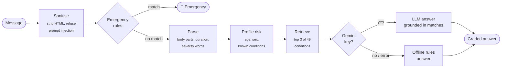

1. **Sanitise.** HTML is stripped; 12 prompt-injection patterns are refused.
2. **Emergency rules first.** The text is normalised (case, apostrophes, punctuation) and matched against phrase patterns for heart, breathing, stroke, crisis, collapse and bleeding. Negation is deliberately ignored: a false alarm is safer than a missed heart attack.
3. **Parse and personalise.** Duration, severity words and the health profile raise the level of concern.
4. **Retrieve.** TF-IDF with field weighting (a condition's name counts more than its description), light stemming and medical synonyms.
5. **Answer.** Gemini writes the reply from the retrieved conditions, or the offline engine builds it; any LLM failure falls back to offline.

### One request, end to end

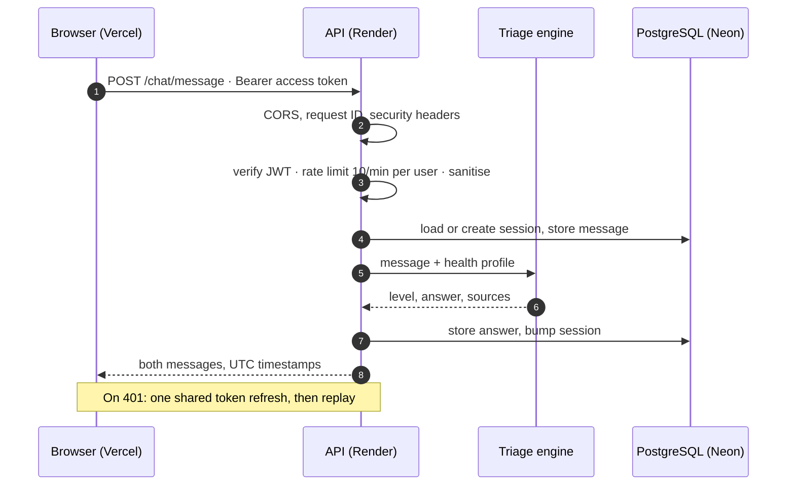

## Architecture

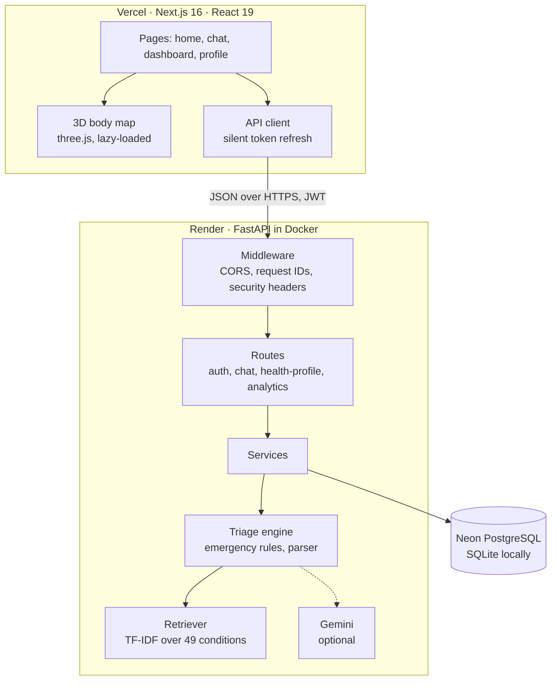

Routes validate and handle HTTP, services hold the logic, models map tables; routes never touch SQL. More in [docs/architecture.md](docs/architecture.md).

<picture>
  <source media="(prefers-color-scheme: dark)" srcset="docs/assets/divider-dark.svg">
  
</picture>

## Engineering

<picture>
  <source media="(prefers-color-scheme: dark)" srcset="docs/assets/activity-dark.svg">
  
</picture>

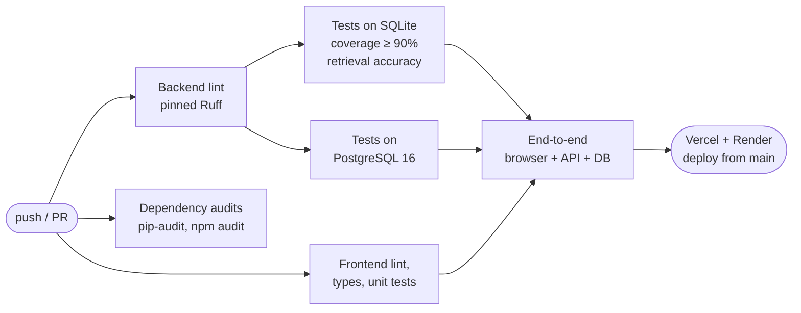

### Security

- Passwords are SHA-256 pre-hashed, then bcrypt (no 72-byte truncation); older hashes upgrade at the next login
- JWT access and refresh tokens with a `type` claim; refresh re-checks that the account is active
- Rate limits: 5/min per IP for sign-in, 10/min **per user** for chat; proxy headers trusted only when configured
- Input sanitising, prompt-injection refusal, and HTML escaped again before rendering
- Foreign keys and cascades enforced by the database, SQLite included
- A malformed `DATABASE_URL` fails without echoing its value, so a typo cannot leak the password into logs
- The API refuses to start in production with the default secret; CORS admits only the web origin
- Dependabot proposes updates after a 14-day cooldown; CI audits shipped dependencies on every push

**Known limitation:** tokens are kept in `localStorage`, which an XSS flaw could read; `httpOnly` cookies are the next step.

<details>
<summary><b>API endpoints</b></summary>

Interactive docs: [carenexus-api.onrender.com/docs](https://carenexus-api.onrender.com/docs) (or locally at `:8000/docs`). All timestamps are UTC with an explicit offset.

| Method | Endpoint | Description | Auth |
|:--|:--|:--|:--|
| POST | `/api/v1/auth/register` | Create an account | |
| POST | `/api/v1/auth/login` | Sign in, receive tokens | |
| POST | `/api/v1/auth/refresh` | New token pair from `{"refresh_token": ...}` | |
| GET | `/api/v1/auth/me` | Current user | Bearer |
| POST | `/api/v1/chat/message` | Send a message, receive a graded answer | Bearer |
| GET | `/api/v1/chat/sessions` | Conversations, most recent activity first | Bearer |
| GET | `/api/v1/chat/sessions/{id}/messages` | Messages of one conversation | Bearer |
| GET POST PUT DELETE | `/api/v1/health-profile/` | Health profile (PUT: `null` clears a field) | Bearer |
| GET | `/api/v1/analytics/overview` | Totals across the server | Bearer |
| GET | `/api/v1/analytics/my-stats` | The caller's own totals | Bearer |
| GET | `/api/v1/analytics/triage-distribution` | Answers per level | Bearer |
| GET | `/api/v1/analytics/daily-usage?days=1..90` | Messages per day | Bearer |
| GET | `/api/v1/analytics/rag-index` | Library size | Bearer |

</details>

<details>
<summary><b>Project structure</b></summary>

```
CareNexus/
├── backend/
│   ├── app/
│   │   ├── api/routes/        auth, chat, health_profile, analytics
│   │   ├── core/              config, database, middleware, rate limiter, sanitiser
│   │   │   └── triage/        engine, emergency rules, symptom parser, prompts
│   │   ├── rag/               knowledge base (49 conditions), vectoriser, synonyms, retriever
│   │   ├── models/ schemas/   SQLAlchemy models, Pydantic schemas
│   │   └── services/          auth, chat, profile, analytics, LLM
│   ├── scripts/               eval_retrieval.py
│   ├── tests/                 pytest suites + labelled retrieval data
│   └── Dockerfile
├── frontend/
│   ├── src/app/               pages
│   ├── src/components/        navbar, chat sidebar, messages, 3D body map
│   ├── src/lib/               API client, design tokens, triage levels (+ unit tests)
│   ├── e2e/                   Playwright tests
│   └── scripts/readme/        generators for this README's artwork
├── docs/                      architecture.md, generated assets
├── .github/workflows/         ci.yml, readme-assets.yml
├── render.yaml                API deployment (Render Blueprint)
└── run.py, start.cmd, start.sh, start.ps1, docker-compose.yml
```

</details>

<details>
<summary><b>How this README keeps itself current</b></summary>

No image here is drawn by hand. Each is generated by a script from the real project, in a dark and a light version that follow your GitHub theme, and carries its own fonts subset to the glyphs it uses (GitHub's image proxy blocks external fonts; subsetting with fontTools keeps each file small).

| Script | Produces | From |
|:--|:--|:--|
| [`banner.mjs`](frontend/scripts/readme/banner.mjs) | animated header | three real engine outputs, the app's fonts and colours |
| [`stats.mjs`](frontend/scripts/readme/stats.mjs) | quality card | pytest, coverage, Vitest, Playwright, retrieval and audit reports |
| [`cards.mjs`](frontend/scripts/readme/cards.mjs) | principles, stack, dividers | `stats.json`, `package.json`, `requirements.txt` |
| [`status.mjs`](frontend/scripts/readme/status.mjs) | production status | live probes of the deployed API and web app |
| [`activity.mjs`](frontend/scripts/readme/activity.mjs) | commit activity | `git log`, bots excluded |
| [`capture.mjs`](frontend/scripts/readme/capture.mjs) | screenshots, demo GIF | Playwright driving the running app, ffmpeg |

[`readme-assets.yml`](.github/workflows/readme-assets.yml) runs them weekly and after relevant pushes, and commits only when something actually changed.

</details>

## Tech stack

<picture>
  <source media="(prefers-color-scheme: dark)" srcset="docs/assets/stack-dark.svg">
  
</picture>

## Disclaimer

CareNexus is a final-year capstone project. It gives general health information and is **not** a substitute for professional medical advice, diagnosis or treatment. In an emergency, call your local emergency number.

<div align="center"><sub>MIT licensed · built by <a href="https://github.com/sarthaksaxenaa">Sarthak Saxena</a></sub></div>
